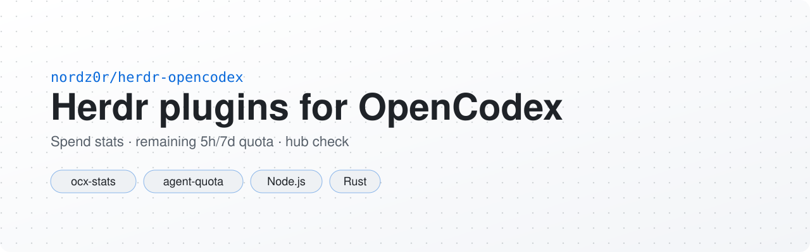
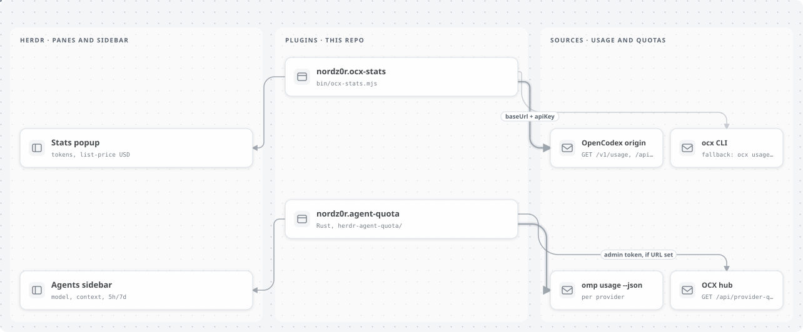

<p align="center">
  <picture>
    <source media="(prefers-color-scheme: dark)" srcset=".github/assets/banner-dark.svg">
    <source media="(prefers-color-scheme: light)" srcset=".github/assets/banner-light.svg">
    
  </picture>
</p>

<p align="center"><b>Русский</b> · <a href="README.en.md">English</a></p>

<p align="center">
  
  
  
  <a href="LICENSE"></a>
  <a href="https://github.com/nordz0r/herdr-opencodex/stargazers"></a>
</p>

Плагины [Herdr](https://herdr.dev/plugins/) для [OpenCodex](https://github.com/lidge-jun/opencodex) (`ocx`):

| Плагин | Установка | Что показывает |
| --- | --- | --- |
| `nordz0r.ocx-stats` | `herdr plugin install nordz0r/herdr-opencodex --yes` | Расход во всплывающем окне: токены in/out, оценка в USD по прайс-листу, по желанию логи запросов |
| `nordz0r.agent-quota` | `herdr plugin install nordz0r/herdr-opencodex/herdr-agent-quota --yes` | Боковая панель агентов: модель, контекст, остаток 5h/7d (в том числе остаток с удалённого хаба для omp-панелей с API-ключом) |

Это репозиторий **плагинов Herdr** (`herdr-plugin.toml` в корне и в `herdr-agent-quota/`), а не skill для omp. Плагины работают от вашего пользователя, поэтому перед установкой просмотрите манифесты.

<p align="center">
  <picture>
    <source media="(prefers-color-scheme: dark)" srcset=".github/assets/architecture-dark.svg">
    <source media="(prefers-color-scheme: light)" srcset=".github/assets/architecture-light.svg">
    
  </picture>
</p>

## Установка

### Маркетплейс

Репозиторий публичный, с топиком `herdr-plugin`. [Маркетплейс Herdr](https://herdr.dev/plugins/) индексирует манифесты из ветки по умолчанию каждые 30 минут. Установка по пути на GitHub:

```bash
herdr plugin install nordz0r/herdr-opencodex --yes
herdr plugin install nordz0r/herdr-opencodex/herdr-agent-quota --yes
herdr plugin list
```

### Локальная разработка

```bash
git clone https://github.com/nordz0r/herdr-opencodex.git
cd herdr-opencodex
herdr plugin link "$(pwd)"
herdr plugin link "$(pwd)/herdr-agent-quota"
```

Для stats нужен Node.js в `PATH`. Плагину quota нужен Rust-тулчейн из `herdr-agent-quota/rust-toolchain.toml` (при установке с GitHub Herdr запускает `cargo build --release`).

## Автоматическая установка через агента

Установку можно поручить coding-агенту (Claude Code, Codex, Cursor, OpenCode и т.п.): вставьте промт ниже в его чат. Шаги повторяют ручную инструкцию из разделов «Установка» и «Использование». Секреты в промте — только плейсхолдеры: агент должен спросить их у вас, записать в файл с правами 0600 и не печатать.

```text
Установи плагины Herdr из репозитория nordz0r/herdr-opencodex, строго по его README.

Правила:
- Ключи и токены не выдумывай, не печатай в вывод и не коммить. Спрашивай их у меня
  и записывай сразу в файл (права 0600). Плейсхолдеры: <OCX_BASE_URL>, <OCX_API_KEY>,
  <HUB_MANAGEMENT_URL>, <HUB_ADMIN_TOKEN>.
- Перед установкой покажи мне herdr-plugin.toml (корень и herdr-agent-quota/) и дождись «да»:
  плагины работают от моего пользователя.
- Если какой-то шаг падает — остановись и покажи ошибку, не обходи её.

1. Проверь зависимости:
   - `herdr --version` (для ocx-stats нужен Herdr >= 0.7.0, для agent-quota >= 0.9.0);
   - `node --version` (нужен для nordz0r.ocx-stats);
   - `cargo --version` / `rustup` (agent-quota собирается через `cargo build --release`,
     тулчейн 1.95.0 из herdr-agent-quota/rust-toolchain.toml);
   - `jq` (нужен для команды проверки ниже).
   Чего не хватает — сообщи и спроси, ставить ли.
2. Спроси, какие плагины ставить: nordz0r.ocx-stats, nordz0r.agent-quota или оба.
3. Установка:
   herdr plugin install nordz0r/herdr-opencodex --yes
   herdr plugin install nordz0r/herdr-opencodex/herdr-agent-quota --yes
   herdr plugin list
4. ocx-stats. Спроси: удалённый OpenCodex (нужны <OCX_BASE_URL> и <OCX_API_KEY>:
   ocx_data_* для токенов, admin/management-ключ для логов) или локальный `ocx` из PATH.
   Для удалённого создай "$(herdr plugin config-dir nordz0r.ocx-stats)/config.json"
   по образцу config.example.json:
   {"baseUrl": "<OCX_BASE_URL>", "apiKey": "<OCX_API_KEY>", "range": "1d", "logLimit": 8}
   (baseUrl без слэша в конце), chmod 600.
5. agent-quota с остатком хаба (только если мне это нужно — спроси):
   - admin-токен хаба <HUB_ADMIN_TOKEN> (с хоста хаба, не клиентский
     ~/.opencodex/admin-api-token) запиши в ~/.opencodex/hub-admin-api-token, chmod 600;
   - CFG="$(herdr plugin config-dir nordz0r.agent-quota)"
     printf '%s\n' '<HUB_MANAGEMENT_URL>' > "$CFG/ocx-hub-url"
     printf '%s\n' "$HOME/.opencodex/hub-admin-api-token" > "$CFG/ocx-hub-admin-token-file"
     herdr plugin action invoke configure --plugin nordz0r.agent-quota
   На Windows конфиг Herdr — %APPDATA%\herdr\config.toml.
6. Проверка успеха:
   - `herdr plugin list` показывает установленные плагины; второго quota-плагина
     (например herdr-agent-usage) быть не должно;
   - ocx-stats: в каталоге плагина выполни
     HERDR_PLUGIN_CONFIG_DIR="$(herdr plugin config-dir nordz0r.ocx-stats)" node bin/ocx-stats.mjs doctor
   - agent-quota:
     ROOT="$(herdr plugin list --json | jq -r '.. | objects | select(.plugin_id? == "nordz0r.agent-quota") | .plugin_root')"
     HERDR_PLUGIN_CONFIG_DIR="$(herdr plugin config-dir nordz0r.agent-quota)" \
       "$ROOT/target/release/herdr-agent-quota" hub-check --provider ocx --model <МОДЕЛЬ_ПАНЕЛИ>
     (код выхода 0; последняя строка — то, что отрисует панель)
     herdr plugin log list --plugin nordz0r.agent-quota --limit 5
7. Отчитайся: что установлено, где лежат конфиги, результат проверок. Значения ключей не выводи.
```

## Использование

### OpenCodex Stats (`nordz0r.ocx-stats`)

Конфиг лежит в каталоге конфигов плагина у Herdr, а не в репозитории:

```bash
herdr plugin config-dir nordz0r.ocx-stats
```

Создайте там `config.json` (образец в `config.example.json`):

```json
{
  "baseUrl": "https://ocx.example.com",
  "apiKey": "ocx_data_… or admin token",
  "range": "1d",
  "logLimit": 8
}
```

- `baseUrl` — адрес удалённого OpenCodex (слэш в конце не нужен).
- `apiKey` — отправляется в `X-OpenCodex-API-Key` и `Authorization: Bearer …`. Для `GET /v1/usage` (токены) хватает ключа data plane `ocx_data_*`. Для логов запросов нужен management/admin-ключ к `GET /api/logs`.
- Если заданы `baseUrl` и `apiKey`, плагин ходит по HTTP, и локальный бинарник `ocx` **не нужен**.
- Если их нет, плагин использует `ocx usage --json` / `ocx logs` из `PATH`.

Не коммитьте настоящие ключи. Плагин ключ никогда не печатает.

| Метрика | Источник | Примечание |
| --- | --- | --- |
| Токены in / out / total | `GET /v1/usage` или `ocx usage --json` | Сумма за период |
| Оценка стоимости (USD) | то же | **Оценка по прайс-листу**, а не счёт провайдера |
| Длительность последних запросов | `GET /api/logs` (необязательно) | Пусто без management-ключа |

`bin/ocx-stats.mjs`: `doctor`, `show`, `watch`. Состояние в `HERDR_PLUGIN_STATE_DIR`.

### Agent Quota с остатком хаба (`nordz0r.agent-quota`)

Основан на [levi-qiao/herdr-agent-quota](https://github.com/levi-qiao/herdr-agent-quota) (MIT). Дополнительный сборщик: если `omp usage --json` пуст для панели OCX с API-ключом, остаток 5h/7d читается из management-эндпоинта хаба `GET /api/provider-quotas`.

Этот эндпоинт отклоняет ключи data plane (401). Положите **admin**-токен хаба в `~/.opencodex/hub-admin-api-token` (права 0600) и укажите его плагину.

На Windows плагин собирается через `cargo` (в `platforms` есть `windows`). Конфиг Herdr там — `%APPDATA%\herdr\config.toml`, а не `~/.config/herdr`. У машины, подключённой к хабу как клиент, есть свой `~/.opencodex/admin-api-token`; это не admin-токен хаба, и `GET /api/provider-quotas` его отклоняет. Берите токен с хоста хаба.

```bash
CFG="$(herdr plugin config-dir nordz0r.agent-quota)"
printf '%s\n' 'https://ocx.example.com' > "$CFG/ocx-hub-url"
printf '%s\n' "$HOME/.opencodex/hub-admin-api-token" > "$CFG/ocx-hub-admin-token-file"
herdr plugin action invoke nordz0r.agent-quota.refresh
```

Модели панелей сопоставляются с отчётами хаба: `grok*` → xAI (только недельный), `gpt*`/`codex` → OpenAI (5h+7d), `glm`/`zai` → Zai, `gemini*` → Google Antigravity (`customWindows` Gem / Gem Weekly). `openrouter/*` → кредиты OpenRouter API, показываются как остаток `$left/$limit` и процент вместо 5h/7d. Ключи кэша — `ocx/{family}`, поэтому такие панели не делят один снимок.

#### Обновление, настройка, проверка

В Herdr нет `plugin update`: переустановка заменяет управляемую копию, снова запускает `cargo build --release` и сохраняет конфиг и состояние плагина. Хук startup при переустановке не запускается. Действие `configure` чинит строки боковой панели, перечитывает конфиг Herdr и затем запускает `startup`, который обновляет все панели и запускает watcher (перезапуск Herdr делает то же самое):

```bash
herdr plugin install nordz0r/herdr-opencodex/herdr-agent-quota --ref main --yes
herdr plugin action invoke configure --plugin nordz0r.agent-quota
```

Конфигурация лежит в `herdr plugin config-dir nordz0r.agent-quota`, одно значение на файл:

| Файл / env | Значение |
| --- | --- |
| `ocx-hub-url` / `HERDR_AGENT_QUOTA_OCX_HUB_URL` | **Management**-адрес хаба (обязателен, дефолта нет: без него хаб не опрашивается и токен никуда не отправляется; `hub-check` выходит с кодом 1). Там должен быть доступен `/api/*`; edge, который публикует только data plane, отвечает `403 Forbidden`. |
| `ocx-hub-admin-token-file` / `HERDR_AGENT_QUOTA_OCX_ADMIN_TOKEN` | Путь к файлу 0600 с admin-токеном хаба (по умолчанию `~/.opencodex/hub-admin-api-token`). Переменная окружения содержит сам токен; используйте её только для ручного запуска. |

Проверка — `hub-check`: он проходит те же шаги, что и панель (`omp usage`, затем хаб), и никогда не печатает токен. Если шаг не прошёл, выходит с кодом 1:

```bash
herdr plugin list   # nordz0r.agent-quota … [github:…@main]; второго quota-плагина вроде herdr-agent-usage быть не должно
ROOT="$(herdr plugin list --json | jq -r '.. | objects | select(.plugin_id? == "nordz0r.agent-quota") | .plugin_root')"
HERDR_PLUGIN_CONFIG_DIR="$(herdr plugin config-dir nordz0r.agent-quota)" \
  "$ROOT/target/release/herdr-agent-quota" hub-check --provider ocx --model openrouter/deepseek/deepseek-v3.2
herdr plugin log list --plugin nordz0r.agent-quota --limit 5
```

Последняя строка `hub-check` показывает, что отрисует панель, например `7d "$0.87/$1.00 87%"` для панели `ocx/openrouter/…`. Панели `gpt*` показывают 5h/7d.

Все настройки, раскладки и другие сборщики: [herdr-agent-quota/README.md](herdr-agent-quota/README.md).

## Доверие

Плагины работают от вашего пользователя с полным доступом к shell и Herdr CLI. Перед установкой просмотрите `herdr-plugin.toml`, `bin/ocx-stats.mjs` и `herdr-agent-quota/`.

## Лицензия

MIT, см. [LICENSE](LICENSE). Плагин quota сохраняет исходное MIT-уведомление Levi Qiao и изменения этой сборки, связанные с остатком квот.
